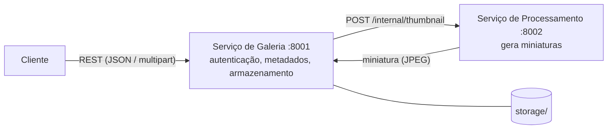

# Galeria Colaborativa de Imagens

Projeto de Sistemas Distribuídos — **Entrega 2 (Comunicação e Core)**.
Repositório de imagens colaborativo: o usuário se cadastra, envia fotos (`multipart/form-data`), lista as imagens (autor, data e miniatura), vê a prévia e baixa o original. O sistema guarda um histórico de uploads.

**Estado atual:** os dois microsserviços rodam e se comunicam de verdade. Upload com autenticação, geração de miniatura pelo Processamento, listagem, prévia, download e histórico funcionam via `curl`. Os dois serviços atendem requisições concorrentes e exibem logs estruturados em JSON.

## Tecnologia escolhida

**Python + FastAPI** (API RESTful sobre HTTP), com Pillow para gerar miniaturas e httpx para um serviço chamar o outro.

Justificativa: o FastAPI permite criar cada microsserviço em poucas linhas, em porta própria, com suporte nativo a `multipart/form-data`, validação de dados e rotas assíncronas (`async`), o que permite atender vários clientes ao mesmo tempo. Ele também gera a documentação interativa das rotas em `/docs`. É uma alternativa equivalente às tecnologias sugeridas no enunciado.

## Arquitetura



| Serviço | Porta | Responsabilidade |
|---|---|---|
| Galeria (`gallery_service`) | 8001 | Cadastro/login, validação do upload, armazenamento, metadados, listagem, prévia, download e histórico |
| Processamento (`processing_service`) | 8002 | Recebe a imagem original e devolve a miniatura (lado máximo 256 px) |

**Como um chama o outro:** no upload, a Galeria valida o arquivo e envia a imagem ao Processamento (`POST /internal/thumbnail`). O Processamento devolve a miniatura em JPEG, e a Galeria grava original e miniatura em disco, registra os metadados e o histórico. Se o Processamento estiver fora do ar, o upload falha com `503`.

## Estado central (Galeria, em memória)

| Estrutura | Conteúdo |
|---|---|
| `usuarios` | `username → hash da senha` (PBKDF2-SHA256 com salt aleatório) |
| `tokens` | `token → username` (sessões) |
| `imagens` | `id → {id, autor, data, nome, tipo, tamanho, caminho_original, caminho_miniatura, url_miniatura}` |
| `historico` | lista de uploads `{usuario, image_id, nome, data}` |

Os metadados ficam em memória; reiniciar a Galeria zera os dados (decisão simplificadora; persistência fica para as próximas entregas). Os caminhos em disco nunca são devolvidos ao cliente.

**Armazenamento em pastas por usuário:**
```
storage/
├── originals/<usuario>/<id>.<jpg|png|gif|webp>
└── thumbnails/<usuario>/<id>.jpg
```

## Validações implementadas

| Regra | Resposta |
|---|---|
| Rotas de imagens e histórico exigem token válido (`Authorization: Bearer <token>`) | 401 |
| Tipo aceito: `image/jpeg`, `image/png`, `image/gif`, `image/webp` | 415 |
| Arquivo obrigatório | 422 |
| Arquivo não vazio | 400 |
| Tamanho máximo de 5 MB | 413 |
| Arquivo corrompido (detectado pelo Processamento e repassado) | 422 |
| Processamento fora do ar | 503 |
| Imagem inexistente ou arquivo removido do disco | 404 |
| `username` com 3–30 caracteres, `password` com mínimo de 6 | 422 |
| `username` único | 409 |
| Login com credenciais erradas | 401 |

## Concorrência

- A Galeria chama o Processamento com um `httpx.AsyncClient` criado uma única vez (no `lifespan`) e reutilizado, então a espera pela miniatura não bloqueia as outras requisições. O timeout é configurável com `PROCESSING_TIMEOUT_SECONDS` (padrão 10 s).
- No Processamento, o trabalho de CPU do Pillow roda em uma thread separada (`run_in_threadpool`), fora do event loop.
- **Não use `--workers` maior que 1** no uvicorn: o estado é em memória, e cada worker teria seus próprios usuários e tokens. A concorrência vem do `async`.

O script `scripts/teste_concorrencia.py` cadastra N usuários e dispara N uploads simultâneos. Com os serviços rodando:

```bash
python scripts/teste_concorrencia.py --total 30
```

Resultado obtido no QA desta entrega: `Uploads solicitados: 30 · Sucessos: 30 · Falhas: 0 · Tempo total: 0.60 segundos`.

## Logs

Cada requisição gera uma linha JSON no console (`stdout`) com `servico`, `metodo`, `rota`, `status`, `duracao_ms` e `usuario` (resolvido pelo token). Eventos de negócio também são registrados: `upload_concluido`, `chamada_processamento`, `falha_miniatura`, `login_falhou`, `thumbnail_entrada` e `thumbnail_resultado`.

Trecho real de um upload (saída dos dois serviços):

```json
{"timestamp": "2026-11-22T18:10:58.939+00:00", "evento": "http_request", "servico": "gallery", "metodo": "POST", "rota": "/auth/login", "status": 200, "duracao_ms": 33.3, "usuario": null}
{"timestamp": "2026-11-22T18:10:58.988+00:00", "evento": "thumbnail_entrada", "servico": "processing", "arquivo": "foto.png"}
{"timestamp": "2026-11-22T18:10:58.993+00:00", "evento": "thumbnail_resultado", "servico": "processing", "status": 200, "tamanho": 1397}
{"timestamp": "2026-11-22T18:10:58.994+00:00", "evento": "chamada_processamento", "servico": "gallery", "status": 200, "duracao_ms": 9.74}
{"timestamp": "2026-11-22T18:10:58.995+00:00", "evento": "upload_concluido", "servico": "gallery", "usuario": "smoke_1795371058", "id": "56f507f4-e375-4c85-b38d-7b3b1595da65", "tamanho": 2786}
{"timestamp": "2026-11-22T18:10:58.995+00:00", "evento": "http_request", "servico": "gallery", "metodo": "POST", "rota": "/images", "status": 201, "duracao_ms": 11.19, "usuario": "smoke_1795371058"}
{"timestamp": "2026-11-22T18:10:59.021+00:00", "evento": "http_request", "servico": "gallery", "metodo": "GET", "rota": "/images", "status": 200, "duracao_ms": 0.81, "usuario": "smoke_1795371058"}
```

## Rotas

**Galeria (:8001)**

| Método | Rota | Descrição |
|---|---|---|
| GET | `/health` | health-check |
| POST | `/auth/register` | cadastro |
| POST | `/auth/login` | login (devolve token) |
| POST | `/images` | upload (`multipart/form-data`, campo `file`) |
| GET | `/images` | listagem JSON: autor, data e URL da miniatura |
| GET | `/images/{id}/thumbnail` | prévia |
| GET | `/images/{id}/download` | download do original |
| GET | `/history` | histórico de uploads do usuário logado |

**Processamento (:8002, rota interna)**

| Método | Rota | Descrição |
|---|---|---|
| GET | `/health` | health-check |
| POST | `/internal/thumbnail` | recebe a imagem e devolve a miniatura |

Exemplos de request/response e códigos HTTP: [`docs/api.md`](docs/api.md).

## Estrutura de pastas

```
.
├── gallery_service/main.py       # Serviço de Galeria
├── processing_service/main.py    # Serviço de Processamento
├── common/logging_config.py      # logs JSON e middleware HTTP
├── scripts/
│   ├── rodar.sh / rodar.ps1      # sobe os dois serviços juntos
│   ├── smoke_test.sh             # fluxo completo com curl
│   └── teste_concorrencia.py     # uploads simultâneos
├── tests/                        # pytest: test_galeria, test_processamento, test_regras
├── storage/                      # imagens enviadas (ignoradas pelo git)
├── docs/api.md                   # contrato da API
├── requirements.txt              # dependências com versões fixas
└── README.md
```

## Como rodar

Requer **Python 3.11+** e `curl`.

### 1. Ambiente

```bash
# Linux/macOS
python3 -m venv .venv
source .venv/bin/activate
```

No Windows PowerShell:

```powershell
py -3 -m venv .venv
.venv\Scripts\Activate.ps1
```

Depois, em qualquer sistema:

```bash
pip install -r requirements.txt
```

### 2. Subir os dois serviços juntos

```bash
# Linux/macOS
./scripts/rodar.sh
```

```powershell
# Windows PowerShell
.\scripts\rodar.ps1
```

O script sobe o Processamento (:8002), espera ele responder e sobe a Galeria (:8001). `Ctrl+C` encerra os dois.

Alternativa manual, em **dois terminais** na raiz do projeto:

```bash
# terminal 1 — Processamento
python -m uvicorn processing_service.main:app --port 8002

# terminal 2 — Galeria
python -m uvicorn gallery_service.main:app --port 8001
```

Documentação interativa: http://localhost:8001/docs

### 3. Testar

Com os serviços rodando, em outro terminal:

```bash
./scripts/smoke_test.sh
```

O smoke test faz cadastro → login → upload → listagem → prévia → download → histórico contra os serviços reais e mostra `OK` ou `FALHOU` em cada passo (no Windows, rode pelo Git Bash ou WSL).

Testes automatizados (não precisam dos serviços no ar):

```bash
python -m pytest
```

## Exemplos com curl

```bash
# cadastro
curl -X POST localhost:8001/auth/register -H "Content-Type: application/json" \
  -d '{"username": "ana", "password": "segredo"}'

# login: guarda o token na variável TOKEN
TOKEN=$(curl -s -X POST localhost:8001/auth/login -H "Content-Type: application/json" \
  -d '{"username": "ana", "password": "segredo"}' | python -c 'import sys, json; print(json.load(sys.stdin)["token"])')

# upload (multipart/form-data, campo file)
curl -X POST localhost:8001/images -H "Authorization: Bearer $TOKEN" -F "file=@foto.png"

# listagem (autor, data e URL da miniatura)
curl localhost:8001/images -H "Authorization: Bearer $TOKEN"

# prévia (miniatura JPEG) — troque <id> pelo id devolvido no upload
curl -o miniatura.jpg localhost:8001/images/<id>/thumbnail -H "Authorization: Bearer $TOKEN"

# download do original, com o nome enviado
curl -OJ localhost:8001/images/<id>/download -H "Authorization: Bearer $TOKEN"

# histórico de uploads do usuário
curl localhost:8001/history -H "Authorization: Bearer $TOKEN"
```

## Equipe

- Gustavo José Carneiro Leão Neto
- Kauã Wallace Silva Melo
- Luiz Ribeiro da Silva Neto
- Ithalo Henrique Ferreira dos Santos Silva
