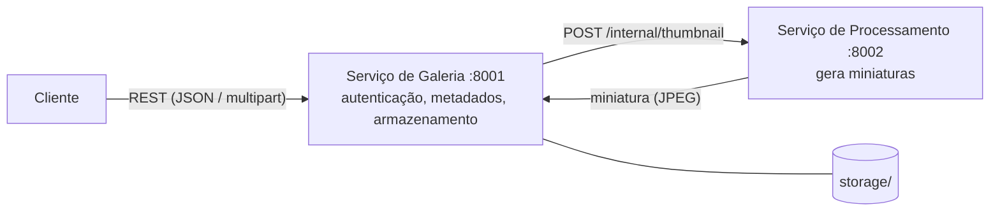

# Galeria Colaborativa de Imagens

Projeto de Sistemas Distribuídos — **Entrega 1 (Arquitetura e Escopo)**.
Repositório de imagens colaborativo: o usuário se cadastra, envia fotos (`multipart/form-data`), lista as imagens (autor, data e miniatura), vê a prévia e baixa o original. O sistema guarda um histórico de uploads.

## Tecnologia escolhida

**Python + FastAPI** (API RESTful sobre HTTP), com Pillow para gerar miniaturas e httpx para um serviço chamar o outro.

Justificativa: o FastAPI permite criar cada microsserviço em poucas linhas, em porta própria, com suporte nativo a `multipart/form-data` e validação de dados. Ele também gera a documentação interativa das rotas em `/docs`. É uma alternativa equivalente às tecnologias sugeridas no enunciado.

## Arquitetura



| Serviço | Porta | Responsabilidade |
|---|---|---|
| Galeria (`gallery_service`) | 8001 | Cadastro/login, validação do upload, armazenamento, metadados, listagem, prévia, download e histórico |
| Processamento (`processing_service`) | 8002 | Recebe a imagem original e devolve a miniatura (lado máximo 256 px) |

**Como um chama o outro:** no upload, a Galeria valida o arquivo e envia a imagem ao Processamento (`POST /internal/thumbnail`). O Processamento devolve a miniatura em JPEG, e a Galeria grava original e miniatura em disco, registra os metadados e o histórico. Se o Processamento estiver fora do ar, o upload falha com `503`.

## Estado central (Galeria, em memória)

| Estrutura | Conteúdo |
|---|---|
| `usuarios` | `username → hash da senha` |
| `tokens` | `token → username` (sessões) |
| `imagens` | `id → {id, autor, data, nome, tipo, tamanho, caminho_original, url_miniatura}` |
| `historico` | lista de uploads `{usuario, image_id, nome, data}` |

Os metadados ficam em memória; reiniciar a Galeria zera os dados em memória (decisão simplificadora desta entrega).

**Armazenamento em pastas por usuário:**
```
storage/
├── originals/<usuario>/<id>.<jpg|png|gif|webp>
└── thumbnails/<usuario>/<id>.jpg
```

## Validações implementadas

| Regra | Resposta |
|---|---|
| Upload e listagem exigem token (`Authorization: Bearer <token>`) | 401 |
| Tipo aceito: `image/jpeg`, `image/png`, `image/gif`, `image/webp` | 415 |
| Arquivo obrigatório | 422 |
| Arquivo não vazio | 400 |
| Tamanho máximo de 5 MB | 413 |
| `username` com 3–30 caracteres, `password` com mínimo de 6 | 422 |
| `username` único | 409 |
| Arquivo corrompido (Processamento) | 422 |

## Rotas

**Galeria (:8001)**

| Método | Rota | Descrição |
|---|---|---|
| GET | `/health` | health-check |
| POST | `/auth/register` | cadastro |
| POST | `/auth/login` | login (devolve token) |
| POST | `/images` | upload (`multipart/form-data`, campo `file`) |
| GET | `/images` | listagem JSON: autor, data e URL da miniatura |
| GET | `/images/{id}/thumbnail` | prévia |
| GET | `/images/{id}/download` | download do original |
| GET | `/history` | histórico de uploads do usuário |

**Processamento (:8002, rota interna)**

| Método | Rota | Descrição |
|---|---|---|
| GET | `/health` | health-check |
| POST | `/internal/thumbnail` | recebe a imagem e devolve a miniatura |

Exemplos de request/response e códigos HTTP: [`docs/api.md`](docs/api.md).

## Estrutura de pastas

```
.
├── gallery_service/main.py      # Serviço de Galeria
├── processing_service/main.py   # Serviço de Processamento
├── tests/test_api.py            # testes automatizados
├── storage/                     # imagens enviadas (ignoradas pelo git)
├── docs/api.md                  # contrato da API
├── requirements.txt
└── README.md
```

## Como rodar

Requer Python 3.10+.

```bash
# Linux/macOS
python3 -m venv .venv
source .venv/bin/activate
```

No Windows PowerShell:

```powershell
py -3 -m venv .venv
.venv\Scripts\Activate.ps1
```

No Prompt de Comando (cmd):

```bat
py -3 -m venv .venv
.venv\Scripts\activate.bat
```

Depois, em qualquer sistema:

```bash
pip install -r requirements.txt
```

Abra **dois terminais** na raiz do projeto:

```bash
# terminal 1 — Processamento
python -m uvicorn processing_service.main:app --port 8002

# terminal 2 — Galeria
python -m uvicorn gallery_service.main:app --port 8001
```

Teste:
```bash
curl http://localhost:8001/health
curl http://localhost:8002/health
```
Documentação interativa: http://localhost:8001/docs

Testes automatizados: `python -m pytest`

## Equipe
